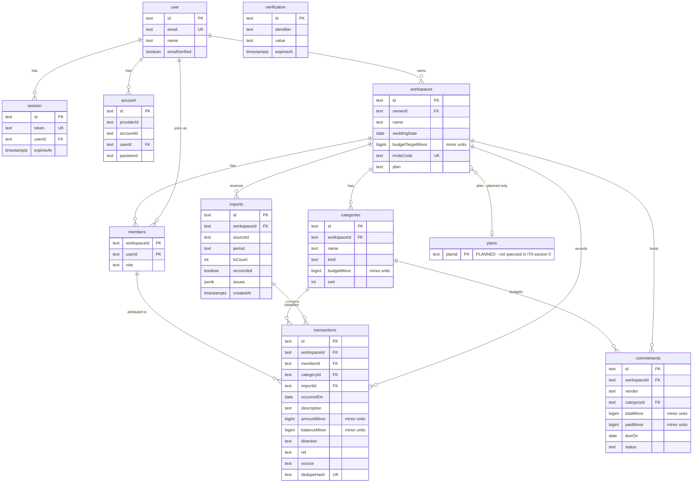

# ERD — SahFund Data Model

## 1. Overview

This document is a **derived** entity-relationship diagram of the SahFund database, transcribed from **`ITA §5` (Data Architecture)** with functional detail cross-checked against the BRD. It exists to give implementers one readable place to see entities, keys, relationships, and constraints before the Drizzle schema is authored.

- **Not a source of truth.** The sources of truth remain, in order: ITA > BRD > PEP (`docs/README.md`). If anything here disagrees with `ITA §5`, the ITA wins — and please fix this document, not the other way around.
- **Status: pre-schema.** As of this writing there is **no Drizzle schema code anywhere in the repository**: `src/lib/db/schema.ts` (per `AGENTS.md` §2) does not exist, `apps/frontend/src/lib/db/index.ts` contains only the lazy `neon-http` client, and no migration SQL exists. The only file named `schema.ts` in the repo (`apps/frontend/src/lib/auth/schema.ts`) is a Zod form schema, not database tables. Nothing in this document has been migrated.
- **Language:** English, matching ITA/BRD. (Product UI copy is Bahasa Indonesia; this is a project document.)

**Conventions used below**

- **Money is `BIGINT` minor units (1/100 rupiah).** Floats are banned from storage and aggregation (`ITA §5`, ADR-07, `BRD NFR-03`). Money columns are named `…Minor`.
- **Types** are illustrative PostgreSQL types, except money columns where `BIGINT` is mandated. Exact types are decided when the Drizzle schema is authored.
- **Nullability:** a column is `NOT NULL` unless a source marks it optional (`?` in `ITA §5`, or `Required: no` / `?` in the BRD), which the Source cell then cites. Where nullability is *this document's* inference, the cell says **inferred**.
- **Inferences are labelled.** Anything not stated in a source document — usually ON DELETE behaviour or a column the docs imply but never list — is marked **inferred** in the row itself.
- Citations use stable heading anchors: `ITA §N`, `BRD §N` (e.g. `BRD FR-05`, `BRD §3`).

---

## 2. Diagram



**Reading notes**

- **Attribute lists show key columns only**; the full column tables are in §3 below.
- **`plans` is planned, not specced.** Mermaid cannot draw a dashed entity, so the caveat is carried by the attribute comment (`PLANNED - not specced in ITA section 5`) and its relationship label. There is no `plans` table row in `ITA §5`; the only concrete artefact today is the `workspaces.plan` column. See §6 and §7.
- **`verification` has no drawn edge** on purpose: Better Auth keys it by `identifier` (an email string), with no foreign key to `user` (`ITA §5`).
- The four Better Auth tables are further constrained by `ITA §11.6` — see §3.

---

## 3. Entities

### Better Auth tables

> **Generated via `@better-auth/cli`, never hand-written (`ITA §11.6`).** These four tables are listed with **key columns only**; the CLI generates the full table (including surrogate `id` primary keys, timestamps, and any Better Auth version-specific columns). Diff generated output against `schema.ts` on upgrade instead of maintaining these by hand.

<details>
<summary><strong><code>user</code>, <code>session</code>, <code>account</code>, <code>verification</code></strong> — click to expand</summary>

#### `user`

| Column | Type | Null | Key | Uniqueness | Source |
|---|---|---|---|---|---|
| id | text | NOT NULL | PK | — | `ITA §5` |
| email | text | NOT NULL | — | UNIQUE | `ITA §5` (email unique); `BRD FR-01` |
| name | text | NOT NULL | — | — | `ITA §5`; `BRD FR-01` (displayed as contributor name) |
| emailVerified | boolean | NOT NULL | — | — | `ITA §5` |

#### `session`

| Column | Type | Null | Key | Uniqueness | Source |
|---|---|---|---|---|---|
| id | text | NOT NULL | PK | — | **inferred** — not in the `ITA §5` key list; CLI-generated (`ITA §11.6`) |
| token | text | NOT NULL | — | UNIQUE | `ITA §5` (token unique); cookie carries the token only |
| userId | text | NOT NULL | FK → `user` | — | `ITA §5` |
| expiresAt | timestamptz | NOT NULL | — | — | `ITA §5` |

Index: `session(userId)` — `ITA §5`.

#### `account`

| Column | Type | Null | Key | Uniqueness | Source |
|---|---|---|---|---|---|
| id | text | NOT NULL | PK | — | **inferred** — not in the `ITA §5` key list; CLI-generated (`ITA §11.6`) |
| providerId | text | NOT NULL | — | — | `ITA §5` (credential or OAuth link) |
| accountId | text | NOT NULL | — | — | `ITA §5` |
| userId | text | NOT NULL | FK → `user` | — | `ITA §5` |
| password | text | NULL | — | — | `ITA §5`; nullability **inferred** — an OAuth link carries no password |

#### `verification`

| Column | Type | Null | Key | Uniqueness | Source |
|---|---|---|---|---|---|
| id | text | NOT NULL | PK | — | **inferred** — not in the `ITA §5` key list; CLI-generated (`ITA §11.6`) |
| identifier | text | NOT NULL | — | — | `ITA §5` (reserved for email verification) |
| value | text | NOT NULL | — | — | `ITA §5` |
| expiresAt | timestamptz | NOT NULL | — | — | `ITA §5` |

No FK to `user`: rows are keyed by `identifier` (email), not by user id (`ITA §5`). Email verification stays disabled until configured — never lock users out (`ITA §6`).

</details>

### Application tables

#### `workspaces`

| Column | Type | Null | Key | Uniqueness | Source |
|---|---|---|---|---|---|
| id | text | NOT NULL | PK | — | `ITA §5` |
| ownerId | text | NOT NULL | FK → `user` | — | `ITA §5`; `BRD §3` ("one owner per workspace") |
| name | text | NOT NULL | — | — | `ITA §5`; `BRD FR-02` (required) |
| weddingDate | date | NULL | — | — | `BRD FR-02` (`Required: no`; drives the forecast) |
| budgetTargetMinor | bigint | NULL | — | — | `BRD FR-02` (`Required: no`); money `BIGINT` (`ITA §5`, ADR-07) |
| inviteCode | text | NOT NULL | — | UNIQUE | `ITA §5` (inviteCode unique); `BRD FR-02` — the pocket code, see §5 |
| plan | text | NULL | — | — | `ITA §5`; `BRD FR-12`; ADR-09. Nullability/default **inferred** (free is the implicit default; values not specced) — see §6 |

One couple per workspace (`ITA §5`).

#### `members`

| Column | Type | Null | Key | Uniqueness | Source |
|---|---|---|---|---|---|
| workspaceId | text | NOT NULL | PK, FK → `workspaces` | UNIQUE (workspaceId, userId) | `ITA §5` |
| userId | text | NOT NULL | PK, FK → `user` | UNIQUE (workspaceId, userId) | `ITA §5` |
| role | text | NOT NULL | — | — | `ITA §5`; values are `owner` / `member` only (`BRD §3`) |

- The **composite primary key shown here is inferred**: `ITA §5` states `Unique (workspaceId, userId)` but does not say whether the table has a surrogate `id`. Open question §7.4.
- **Two-member cap is NOT a DB constraint** — see §5.

#### `categories`

| Column | Type | Null | Key | Uniqueness | Source |
|---|---|---|---|---|---|
| id | text | NOT NULL | PK | — | **inferred** column existence — `ITA §5` does not list an id, but `BRD FR-05` references `categoryId` |
| workspaceId | text | NOT NULL | FK → `workspaces` | UNIQUE (workspaceId, name) | `ITA §5` |
| name | text | NOT NULL | — | UNIQUE (workspaceId, name) | `ITA §5`; seeded names in `BRD FR-06` |
| kind | text | NOT NULL | — | — | `ITA §5`; values not enumerated in the docs |
| budgetMinor | bigint | NULL | — | — | `ITA §5`; `BRD FR-08` (per-category budget). Nullability **inferred** |
| sort | int | NOT NULL | — | — | `ITA §5`. Nullability **inferred** |

#### `imports`

| Column | Type | Null | Key | Uniqueness | Source |
|---|---|---|---|---|---|
| id | text | NOT NULL | PK | — | **inferred** column existence — implied by `transactions.importId` (`ITA §5`) |
| workspaceId | text | NOT NULL | FK → `workspaces` | — | `ITA §5` |
| sourceId | text | NOT NULL | — | — | `ITA §5`; `BRD FR-03` (POST payload) |
| period | text | NULL | — | — | `ITA §5`; `BRD FR-03` (`Required: no`, e.g. "April 2026") |
| pocketName | text | NOT NULL | — | — | `ITA §5`; `BRD FR-03` (a statement may contain several pockets) |
| txCount | int | NOT NULL | — | — | `ITA §5` (rows per import, max 5,000 — `BRD FR-03`) |
| reconciled | boolean | NOT NULL | — | — | `ITA §5`; `BRD FR-04` — see §6 |
| issues | jsonb | NOT NULL | — | — | `ITA §5`; `BRD FR-04` (kinds: balance_chain, totals, opening, duplicate, empty) |
| createdAt | timestamptz | NOT NULL | — | — | **inferred** column existence — implied by the `imports(workspaceId, createdAt)` index (`ITA §5`) |

One row per upload (`ITA §5`).

#### `transactions`

| Column | Type | Null | Key | Uniqueness | Source |
|---|---|---|---|---|---|
| id | text | NOT NULL | PK | — | Column existence from `BRD FR-05` (`txId` in the PATCH route); not listed in `ITA §5` |
| workspaceId | text | NOT NULL | FK → `workspaces` | UNIQUE (workspaceId, dedupeHash) | `ITA §5` |
| memberId | text | NULL | FK → `members` (**inferred** target) | — | `ITA §5` (`memberId?`); `BRD FR-05`, `BRD FR-07` |
| categoryId | text | NULL | FK → `categories` | — | `ITA §5` (`categoryId?`); `BRD FR-05` |
| occurredOn | date | NOT NULL | — | — | `ITA §5`; `BRD FR-05` (date of the transaction) |
| description | text | NOT NULL | — | — | `ITA §5`; `BRD FR-05` |
| amountMinor | bigint | NOT NULL | — | — | `ITA §5`; `BRD FR-05` (signed; positive = money in) |
| balanceMinor | bigint | NOT NULL | — | — | `ITA §5` |
| direction | text | NOT NULL | — | — | `ITA §5`; values not enumerated in the docs |
| ref | text | NULL | — | — | `ITA §5`; optional per `ITA §4` (`ref?` on `Tx`) |
| source | text | NOT NULL | — | — | `ITA §5`; `BRD FR-05` (`import` or `manual`) |
| importId | text | NULL | FK → `imports` | — | `ITA §5` (`importId?` — null for manual rows) |
| dedupeHash | text | NOT NULL | — | UNIQUE (workspaceId, dedupeHash) | `ITA §5` — see §5 and §6 |

> **No `contributions` table. FR-07 attribution is the optional `transactions.memberId` column.** A separate contribution/attribution table must not be invented later: bulk-assigning a member to rows (`BRD FR-07`) is an `UPDATE transactions SET memberId …` against this column, and the per-member report aggregates `amountMinor` grouped by it.

#### `commitments`

| Column | Type | Null | Key | Uniqueness | Source |
|---|---|---|---|---|---|
| id | text | NOT NULL | PK | — | **inferred** — no doc references a commitment id, but a stable handle is required for updates; not listed in `ITA §5` |
| workspaceId | text | NOT NULL | FK → `workspaces` | — | `ITA §5` |
| vendor | text | NOT NULL | — | — | `ITA §5`; `BRD FR-09` |
| categoryId | text | NULL | FK → `categories` | — | `ITA §5` (`categoryId?`); `BRD FR-09` |
| totalMinor | bigint | NOT NULL | — | — | `ITA §5`; `BRD FR-09` (signed contract total) |
| paidMinor | bigint | NOT NULL | — | — | `ITA §5`; `BRD FR-09` (paid so far) |
| dueOn | date | NULL | — | — | `ITA §5`; `BRD FR-09` (`dueOn?`) |
| status | text | NOT NULL | — | — | `ITA §5`; values not enumerated in the docs |

A vendor contract exists independently of the transactions that pay it (`BRD FR-09`); contracts, not payments (`ITA §5`).

#### `plans` — planned, not specced

| Column | Type | Null | Key | Uniqueness | Source |
|---|---|---|---|---|---|
| planId | text | NOT NULL | PK | — | **Planned only — no `ITA §5` row exists.** Driven by `BRD FR-12` (free/paid state) and `ITA` ADR-09 |

**The only concrete column today is `workspaces.plan`** (§3 above). No `plans` table may be migrated until the open question in §7.2 is resolved; until then the diagram shows it dashed-equivalent — labelled `PLANNED - not specced in ITA section 5` — purely so nobody mistakes it for existing schema.

---

## 4. Relationships

Cardinality is written as "per parent → children". ON DELETE entries not stated in a source document are labelled **inferred**.

| # | Edge | Cardinality | ON DELETE | Source |
|---|---|---|---|---|
| 1 | `user` → `session` | one `user` → zero-or-more `session` | CASCADE — **inferred** (Better Auth owns its rows; `ITA §5` does not state it) | `ITA §5` |
| 2 | `user` → `account` | one `user` → zero-or-more `account` | CASCADE — **inferred** (as above) | `ITA §5` |
| 3 | `user` → `verification` | **no FK edge** — keyed by `identifier` (email string) | n/a | `ITA §5` |
| 4 | `user` → `workspaces` (ownerId) | one `user` → zero-or-more `workspaces` | RESTRICT — **inferred** (workspace deletion is an explicit owner action, `BRD FR-12`; nothing says account removal cascades financial rows) | `ITA §5`; `BRD §3`, `BRD FR-12` |
| 5 | `user` → `members` (userId) | one `user` → zero-or-more `members` | CASCADE — **inferred** (a user with no account cannot hold a membership) | `ITA §5` |
| 6 | `workspaces` → `members` | one `workspaces` → zero-or-more `members` | **CASCADE** (stated: deletion cascades from `workspaces`) | `ITA §5` (Retention) |
| 7 | `workspaces` → `categories` | one `workspaces` → zero-or-more `categories` | **CASCADE** (stated) | `ITA §5` (Retention) |
| 8 | `workspaces` → `imports` | one `workspaces` → zero-or-more `imports` | **CASCADE** (stated) | `ITA §5` (Retention) |
| 9 | `workspaces` → `transactions` | one `workspaces` → zero-or-more `transactions` | **CASCADE** (stated) | `ITA §5` (Retention) |
| 10 | `workspaces` → `commitments` | one `workspaces` → zero-or-more `commitments` | **CASCADE** (stated) | `ITA §5` (Retention) |
| 11 | `imports` → `transactions` (importId) | one `imports` → zero-or-many `transactions` (0..1 on the child side — manual rows are null) | RESTRICT — **inferred** (transactions live until the workspace is deleted, so an import row must not be deletable out from under its rows) | `ITA §5` |
| 12 | `categories` → `transactions` (categoryId) | one `categories` → zero-or-many `transactions` (0..1 on the child side) | SET NULL — **inferred** (`categoryId` is nullable, so rows survive as uncategorised) | `ITA §5`; `BRD FR-05` |
| 13 | `members` → `transactions` (memberId) | one `members` → zero-or-many `transactions` (0..1 on the child side) | SET NULL — **inferred** (attribution drops, the row itself is money data and must survive) | `ITA §5`; `BRD FR-05`, `BRD FR-07` |
| 14 | `categories` → `commitments` (categoryId) | one `categories` → zero-or-many `commitments` (0..1 on the child side) | SET NULL — **inferred** (same reasoning as #12) | `ITA §5`; `BRD FR-09` |
| 15 | `workspaces` → `plans` | many `workspaces` → zero-or-one `plans` — **planned only** | n/a — no FK exists today; `workspaces.plan` is a plain column until §7.2 is resolved | `BRD FR-12`; `ITA` ADR-09 |

Notes:

- Every workspace-scoped query must be scoped by `workspaceId` with membership verified in the handler (`ITA §7`); a row id from a URL is never sufficient on its own.
- Edges #6–#10 are the retention rule in prose form: "Transactions and imports live until the workspace is deleted. Deletion cascades from `workspaces`" (`ITA §5`). The remaining CASCADE/RESTRICT/SET NULL choices are this document's **inferred** defaults — see §7.3.

---

## 5. Constraints & indexes

### Dedupe rule

```
dedupe_hash = sha256(workspaceId | date | time | amountMinor | balanceMinor | ref)
```

- Enforced by `UNIQUE (workspaceId, dedupeHash)` (`ITA §5`).
- Re-importing an overlapping month is a **no-op**, not an error and not a doubled balance (`ITA §5`); never delete-and-reinsert to "refresh" a month. The hash is computed by exactly one implementation shared by import, re-import, and manual-entry conflict checks (`AGENTS.md` §7).

### Unique constraints

| Constraint | Table | Source |
|---|---|---|
| `user.email` UNIQUE | `user` | `ITA §5` |
| `session.token` UNIQUE | `session` | `ITA §5` |
| `workspaces.inviteCode` UNIQUE | `workspaces` | `ITA §5`; `BRD FR-02` |
| `members` UNIQUE (workspaceId, userId) | `members` | `ITA §5` |
| `categories` UNIQUE (workspaceId, name) | `categories` | `ITA §5` |
| `transactions` UNIQUE (workspaceId, dedupeHash) | `transactions` | `ITA §5` |

### Indexes (`ITA §5`)

| Index | Serves |
|---|---|
| `transactions(workspaceId, occurredOn)` | ledger date-range scans (`BRD FR-05`) |
| `transactions(categoryId)` | budget-vs-actual grouping (`BRD FR-08`) |
| `session(userId)` | session lookup during auth (`BRD FR-01`) |
| `imports(workspaceId, createdAt)` | import history per workspace |
| `commitments(workspaceId, dueOn)` | next-due list on the dashboard (`BRD FR-09`) |

### Two-member cap — handler-enforced, NOT a DB constraint

**Flagged honestly:** the hard limit of two members per workspace (`BRD FR-02`) is enforced **in the join handler** — `ITA §5` says so verbatim ("max 2 enforced in the handler"). `UNIQUE (workspaceId, userId)` only prevents the *same* user joining twice; **no CHECK constraint, trigger, or partial index limits a workspace to two rows**. The schema does not enforce the cap, and nothing in this document should be read as if it does. A third join attempt must return a clear message, never a silent failure (`BRD FR-02`).

### Pocket code (`workspaces.inviteCode`)

- **Format:** exactly 10 characters in fixed order — **4 digits, then 3 letters, then 3 alphanumeric** — e.g. `4821kPz7xQ` (`ITA §5`; `BRD FR-02`).
- **Generation:** server-side from a cryptographically secure random source (CSPRNG) (`ITA §5`).
- **Collisions:** resolved against the existing `UNIQUE` constraint by **regenerating, never by relaxing the constraint** (`ITA §5`).
- **Rotation:** it is rotated rather than edited in place (`ITA §5`); rotatable by the owner (`BRD FR-02`).
- **It is a credential:** the join credential for the workspace — there is no separate invite record (`BRD FR-13`) — so it is **never written to logs or analytics** and never echoed into an error message (`ITA §5`, §11.9; `BRD FR-13` / `BRD NFR-02`).

---

## 6. Derived / computed

| Item | What it is | Semantics | Source |
|---|---|---|---|
| `transactions.dedupeHash` | SHA-256 over `workspaceId \| date \| time \| amountMinor \| balanceMinor \| ref` | **Computed**, never taken from the client: the browser may compute it for the live "Cocok dengan saldo bank" gate, but the server re-runs the same pure function on the posted rows and stores the server result. A re-post of identical rows is absorbed by `UNIQUE (workspaceId, dedupeHash)` — no-op, no doubled balance. | `ITA §5`; server re-check in `ITA §2` |
| `workspaces.plan` | Free/paid state of the workspace | **Derived from the entitlement grant**, not user-editable: the one-time purchase webhook grants entitlement idempotently keyed by order id (`ITA §6`), which then sets `plan`. Free = one import, dashboard visible, export and further imports locked; paid = unlimited imports + export (`BRD FR-12`). No subscription lifecycle exists (ADR-09). A `plans` table is the *planned* normalisation (§7.2). | `ITA §5`; `BRD FR-12`; ADR-09; `ITA §6` |
| `imports.reconciled` + `imports.issues` | Reconciliation outcome of one upload | **A failed reconciliation still stores the import** — with `reconciled = false` and `issues` (jsonb) populated — rather than rejecting the upload. Such imports are excluded from trusted totals until the user confirms the data; the green "Cocok dengan saldo bank" state appears only when reconciliation is ok (`BRD FR-04`). Issue kinds: `balance_chain`, `totals`, `opening`, `duplicate`, `empty`. | `ITA §5`; `BRD FR-04` |

**Observation (not specced):** `time` is an input to `dedupeHash`, but `ITA §5` lists **no time column** on `transactions` (only `occurredOn`, a date). The hash is therefore computed from the parsed row at write time; it cannot be recomputed from stored columns alone. If that is ever needed, a time column must be added deliberately — flag it in a future ITA §5 revision rather than discovering it mid-migration.

---

## 7. Open questions

1. **Share-report token has no table (`BRD FR-11` vs `ITA §5`).** FR-11 specces `POST /w/:id/share → { token, url, expiresAt }` and an unauthenticated `GET /r/:token` that is read-only, expiring, and revocable — yet `ITA §5` lists **no entity** that stores a token. It is deliberately omitted from the diagram. Options: (a) a new `share_tokens`-style table (workspaceId, token, expiresAt, revokedAt) — keeps revocation and expiry queryable; (b) columns on `workspaces` — fewer tables, but conflates one credential with the workspace row. **Needs an ITA §5 addendum before schema authoring.**
2. **Entitlement: table vs `workspaces.plan` column.** ADR-09 / `ITA §6` require an idempotent grant **keyed by order id** (retry on 5xx is safe because the grant is keyed by order id), which implies some record of orders/grants — but `ITA §5` contains only the `workspaces.plan` column. Where does the order id live? Options: (a) a small `orders`/grants table (audit + idempotency key); (b) `workspaces.plan` only, with idempotency handled at the webhook layer — simpler, but no persisted receipt. This also decides the shape of the planned `plans` entity in §3.
3. **Should the *inferred* ON DELETE rules be pinned?** Rows #1, #2, #4, #5, #11, #12, #13, #14 in §4 are this document's inferences; only the workspace cascade (#6–#10) is stated in `ITA §5`. Recommend: write them explicitly into the first migration (expand/contract, `ITA §5` Migrations) so they are deliberate decisions rather than driver defaults — but they must be confirmed, not assumed, before the migration is generated.
4. **What does `transactions.memberId` actually reference?** `ITA §5` lists `members` key fields as `workspaceId, userId, role` with `UNIQUE (workspaceId, userId)` — **no surrogate id**. Is `memberId` a `userId` (FK → `user`, globally unique) or a membership key (which would need a surrogate `id` or a composite FK carrying `workspaceId` too)? This also settles whether the composite PK shown for `members` in §2/§3 is right. Choosing wrong breaks the FR-07 per-member report (`BRD FR-07`).

---

## 8. Derivation sources

Traceability from every item in this document back to a doc row.

| Item | Source |
|---|---|
| `user` | `ITA §5` (row `user`); `BRD FR-01` |
| `session` | `ITA §5` (row `session`); `BRD FR-01` (server-side validation); cookie carries token only — `ITA §7` |
| `account` | `ITA §5` (row `account`); ADR-04 |
| `verification` | `ITA §5` (row `verification`); activation gating — `ITA §6` |
| `workspaces` | `ITA §5` (row `workspaces`); `BRD FR-02`; one owner — `BRD §3` |
| `members` | `ITA §5` (row `members`); `BRD FR-02` (join paths, two-member cap) |
| `categories` | `ITA §5` (row `categories`); `BRD FR-06` (seed set), `BRD FR-08` |
| `imports` | `ITA §5` (row `imports`); `BRD FR-03` (payload, ≤ 5,000 rows); `BRD FR-04` |
| `transactions` | `ITA §5` (row `transactions`); `BRD FR-05` (ledger fields); `BRD FR-07` (attribution via `memberId`) |
| `commitments` | `ITA §5` (row `commitments`); `BRD FR-09` |
| `plans` (planned entity) | `BRD FR-12`; `ITA` ADR-09 — **no `ITA §5` row** |
| Ownership edge `user` → `workspaces` | `ITA §5` (`ownerId`); `BRD §3` |
| Workspace cascade (#6–#10) | `ITA §5` Retention; `BRD NFR-06` (delete on request, purge ≤ 30 days) |
| `dedupeHash` formula + unique | `ITA §5` |
| Index list (all five) | `ITA §5` |
| Unique constraints (all six) | `ITA §5` (+ `BRD FR-02` for inviteCode) |
| Pocket-code format / CSPRNG / regenerate / rotate / never-log | `ITA §5`; `BRD FR-02`, `BRD FR-13` |
| Two-member cap = handler, not DB | `ITA §5` (members note); `BRD FR-02` |
| `reconciled` / `issues` semantics | `ITA §5`; `BRD FR-04` |
| `workspaces.plan` | `ITA §5`; `BRD FR-12`; ADR-09; grant idempotency — `ITA §6` |
| Money as `BIGINT` minor units | `ITA §5`; ADR-07; `BRD NFR-03` |
| Share-report token | `BRD FR-11` — **no `ITA §5` counterpart; open question §7.1** |
| Better Auth table generation | `ITA §11.6` (gotcha 6: `npx @better-auth/cli generate`, diff never hand-write) |
| All *inferred* rows (ON DELETE, surrogate ids, nullability marked as such) | This document's reasoning — none stated in ITA/BRD; see §7.3 |

---

## 9. Out of scope

This document deliberately contains **none** of the following:

- **No migration SQL and no Drizzle code.** No `pgTable`, no `drizzle-kit generate` output, no schema file — this is documentation only. The schema lands in `src/lib/db/schema.ts` (expand/contract only, `ITA §5` Migrations) when implementation starts.
- **No `contributions` table.** FR-07 attribution is the optional `transactions.memberId` column (§3); do not invent a table for it.
- **No share-report token entity** — deferred to open question §7.1 until ITA §5 speaks to it.
- **No entities for v1.0-excluded features** (`BRD §3`, `ITA §1`, `AGENTS.md` §10): OCR · LLM anywhere in the request path · bank API integration · subscription/recurring billing · multi-currency · document/image/avatar storage · native mobile apps · guest list / RSVP / invitations · vendor marketplace · roles beyond owner/member · KV/R2/D1/server-side session cache. If a feature here ever needs one of these, it is a scope change through the BRD, not an ERD edit.
